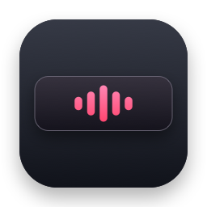

  

<h1 align="center">MediaHub</h1>

Your music, controls, and now-playing updates within reach.

MediaHub is a native macOS menu bar app that brings playback controls to your Touch Bar, shows track updates near the camera, and automatically skips songs or artists you choose to block.

It stays out of your way: no main window, no Dock icon, and no need to switch away from what you are doing.

## What you can do

- **Control playback from the Touch Bar.** Play, pause, change tracks, and seek without opening your player. Podcasts get 15-second skip controls.
- **See what is playing.** A temporary card appears at the top of your screen when a track changes or playback is paused or resumed, with artwork, song, artist, and album information when available.
- **Keep unwanted music out of your queue.** Block a song or artist and let automatic skipping handle future matches.
- **Manage Music favorites.** Add or remove the current song from favorites directly from the Touch Bar.
- **Choose your setup.** Enable Touch Bar controls, notifications, and automatic skipping independently. Use the app in English or Turkish.

## Install

**Requires macOS 27.0 or later.** Touch Bar controls require a MacBook Pro with a Touch Bar. The download contains both Apple Silicon and Intel binaries.

**[Download MediaHub 1.0.0](https://github.com/szrbdk/MediaHub/releases/download/v1.0.0/MediaHub-1.0.0.dmg)** · [All releases](https://github.com/szrbdk/MediaHub/releases)

1. Download and open **MediaHub-1.0.0.dmg**.
2. Drag **MediaHub** into **Applications**.
3. Eject the disk image, then open MediaHub from Applications.
4. Look for the MediaHub icon in your menu bar.

If macOS blocks the first launch and you trust this download, use **System Settings → Privacy & Security → Open Anyway**. See [Apple’s instructions](https://support.apple.com/en-gb/102445).

The menu bar menu is where you turn features on or off, manage your blacklist, change language, or quit. Your choices are remembered the next time you open the app.

MediaHub starts when you open it; it does not add itself to your login items.

## Using the Touch Bar

Use the playback buttons to play, pause, or move between tracks. Hold the previous or next button to seek.

**Tap the time display** to open a larger seek bar. Drag to preview a position, then release to jump there. Tap the time display again to return.

**Tap the song title** to open its actions:

**Favorite → Song and artist → Block song → Block artist**

Tap the title again to return to the playback controls. Tap a highlighted blacklist button again to undo an accidental block.

The favorite button adds or removes favorites in Music.

## Block songs and artists

Open **Add to blacklist** in the menu bar to block the current song or an artist. You can also use the buttons in the Touch Bar song actions. Adding an entry leaves the current song playing; automatic skipping applies when a new track starts.

Open **Manage blacklist** and select an entry to remove it. Turn off **Automatic skipping** whenever you want to listen without the filter.

Matches are exact apart from capitalization and surrounding spaces. Combined artist credits are treated as one name unless the player provides separate artists.

Automatic skipping stops after 10 consecutive skips to avoid getting stuck in a blocked queue. Toggle it off and on to reset the limit.

## Now-playing notifications

A quiet card slides down near the camera, stays visible for a few seconds, and disappears without taking focus. A small play/pause badge shows the playback state. The panel is designed to appear over full-screen apps too.

Turn **Notifications** off in the menu bar to hide it. MediaHub does not change Music's own notification settings; you can disable those separately in System Settings if you see both.

## Language

Choose **English** or **Turkish** from the **Language** menu. Your selection is applied immediately and saved.

## Permissions and compatibility

macOS may ask you to allow MediaHub to control Music when you use favorites. Grant that permission to enable adding and removing favorites.

Available controls, artwork, and track information depend on the player and macOS version.

## License

MediaHub is available under the [MIT License](LICENSE). Copyright © 2026 Sezer Budak.

## Acknowledgments

MediaHub uses [ungive/mediaremote-adapter](https://github.com/ungive/mediaremote-adapter) under the BSD-3-Clause license. The [third-party license](MediaHub/Resources/MediaRemoteAdapter-LICENSE.txt) is included in the repository and application bundle.
