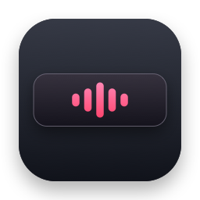

  

<h1 align="center">MediaHub</h1>

Your music, controls, and now-playing updates within reach.

MediaHub is a native macOS menu bar app with Touch Bar controls, a compact on-screen player, now-playing notifications, and automatic skipping for songs or artists you choose to block.

It stays out of your way: no main window, no Dock icon, and no need to switch away from what you are doing.

## What you can do

- **Control playback from the Touch Bar.** Play, pause, change tracks, and seek without opening your player. Podcasts get 15-second skip controls.
- **See what is playing.** Choose a temporary notification or an interactive mini player with artwork, track information, and playback controls.
- **Keep unwanted music out of your queue.** Block a song or artist and let automatic skipping handle future matches.
- **Manage Music favorites.** Add or remove the current song from favorites from the Touch Bar or mini player.
- **Choose your setup.** Use Touch Bar controls, choose your on-screen display, and enable automatic skipping. Use the app in English or Turkish.

## Install

**Requires macOS 27.0 or later.** Touch Bar controls require a MacBook Pro with a Touch Bar. The download contains both Apple Silicon and Intel binaries.

**[Download MediaHub 1.0.0](https://github.com/szrbdk/MediaHub/releases/download/v1.0.0/MediaHub-1.0.0.dmg)** · [All releases](https://github.com/szrbdk/MediaHub/releases)

1. Download and open **MediaHub-1.0.0.dmg**.
2. Drag **MediaHub** into **Applications**.
3. Eject the disk image, then open MediaHub from Applications.
4. Look for the MediaHub icon in your menu bar.

If macOS blocks the first launch and you trust this download, use **System Settings → Privacy & Security → Open Anyway**. See [Apple’s instructions](https://support.apple.com/en-gb/102445).

The menu bar menu is where you turn features on or off, manage your blacklist, change language, or quit. Your choices are remembered the next time you open the app.

MediaHub starts when you open it; it does not add itself to your login items.

## Using the Touch Bar

Use the playback buttons to play, pause, or move between tracks. Hold the previous or next button to seek.

**Tap the time display** to open a larger seek bar. Drag to preview a position, then release to jump there. Tap the time display again to return.

**Tap the song title** to open its actions:

**Favorite → Song and artist → Block song → Block artist**

Tap the title again to return to the playback controls. Tap a highlighted blacklist button again to undo an accidental block.

The favorite button adds or removes favorites in Music.

## Block songs and artists

Open **Add to blacklist** in the menu bar to block the current song or an artist. You can also use the buttons in the Touch Bar song actions. Adding an entry leaves the current song playing; automatic skipping applies when a new track starts.

Open **Manage blacklist** and select an entry to remove it. Turn off **Automatic skipping** whenever you want to listen without the filter.

Matches are exact apart from capitalization and surrounding spaces. Combined artist credits are treated as one name unless the player provides separate artists.

When you go back using the Touch Bar, blocked tracks are skipped backward too.

Automatic skipping stops after 10 consecutive skips to avoid getting stuck in a blocked queue. Toggle it off and on to reset the limit.

## Now-playing notifications

Choose **Notification position** in the menu bar to place notifications at the top or bottom, aligned left, center, or right. The default is top center, and your choice is saved.

A compact card grows from the selected corner or edge, stays visible for a few seconds, and retracts to the same place without taking focus. It shares the mini player's design, with artwork, track, artist, album, and a play/pause badge. The panel is designed to appear over full-screen apps too.

Top notifications float below the menu bar while it is visible and join the screen edge when it is hidden. An opaque dark surface keeps text readable over both light and dark backgrounds.

Choose **On-screen display → Notifications**, **Mini player**, or **Off** in the menu bar. Your selection is saved; notifications and the mini player never appear together. Touch Bar controls work independently. MediaHub does not change Music's own notification settings; you can disable those separately in System Settings if you see both.

## Mini player

The mini player sits in the bottom-right corner of your primary screen, including over full-screen apps. It shows artwork, the track, artist and album, playback controls, a Music favorite button, and a seek bar. Drag the seek bar to preview a position and release to apply it.

The expanded player stays visible until you collapse it. Hover over the artwork to reveal the collapse button. The compact square hides after the pointer has been away for three seconds. Move the pointer to the bottom-right corner briefly to bring it back, then click to expand. With no media playing, you can still reveal the player to see its waiting state.

While collapsed, a track change or a pause/resume briefly opens the same notification card with artwork, title, artist, album, and playback state before returning to the compact or hidden state. It follows the same announcement rules as notifications. The card uses the same size as the expanded player. Transitions grow from the bottom-right corner and shrink back into it.

## Language

Choose **English** or **Turkish** from the **Language** menu. Your selection is applied immediately and saved.

## Permissions and compatibility

macOS may ask you to allow MediaHub to control Music when you use favorites. Grant that permission to enable adding and removing favorites.

Available controls, artwork, and track information depend on the player and macOS version.

## License

MediaHub is available under the [MIT License](LICENSE). Copyright © 2026 Sezer Budak.

## Acknowledgments

MediaHub uses [ungive/mediaremote-adapter](https://github.com/ungive/mediaremote-adapter) under the BSD-3-Clause license. The [third-party license](MediaHub/Resources/MediaRemoteAdapter-LICENSE.txt) is included in the repository and application bundle.
